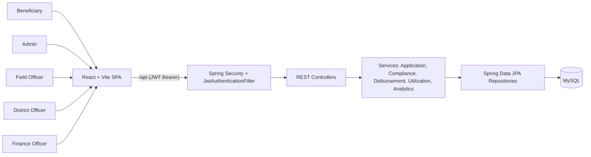

# Grantora (grant-tracking)

Grantora is a full-stack web application for managing government subsidy and grant schemes, beneficiary applications, multi-stage verification, stage-specific compliance tracking, disbursement planning, simulated installment payment recording, and expenditure/utilization verification.

> [!NOTE]
> **Payment Simulation Notice:** Grantora records installment disbursements, payment references (UTR/transaction IDs), and payment methods for tracking and audit purposes only. **No real bank, treasury, PFMS, or payment-gateway transfer is executed.**

## Table of Contents

- [Project Overview](#project-overview)
- [Key Features & Modules](#key-features--modules)
- [Technology Stack](#technology-stack)
- [System Architecture](#system-architecture)
- [Folder Structure](#folder-structure)
- [User Roles & Responsibilities](#user-roles--responsibilities)
- [Application Verification Workflow](#application-verification-workflow)
- [Sequential Compliance Workflow & Document Versioning](#sequential-compliance-workflow--document-versioning)
- [Disbursement Plans & Finance Simulated Payment Process](#disbursement-plans--finance-simulated-payment-process)
- [Expenditure / Utilization Report Workflow](#expenditure--utilization-report-workflow)
- [Database Configuration & Key Tables](#database-configuration--key-tables)
- [Environment Variables](#environment-variables)
- [Installation & Running Locally](#installation--running-locally)
- [API Endpoint Overview](#api-endpoint-overview)
- [Testing & Production Build](#testing--production-build)
- [Deployment & Migration Notes](#deployment--migration-notes)

## Project Overview

- Provide a centralized platform to configure grant schemes, mandatory eligibility rules, and weighted eligibility questionnaires.
- Route submitted applications through a jurisdiction-aware three-stage officer verification pipeline (`FIELD` -> `DISTRICT` -> `FINANCE`).
- Manage staged installment disbursement plans (`Stage 1`, `Stage 2`, `Stage 3`) with stage-specific compliance requirements.
- Enforce sequential `FIELD -> DISTRICT -> FINANCE` compliance reviews with immutable document version history before Finance Officers record simulated payments.
- Track post-release beneficiary expenditure/utilization reports through sequential `FIELD -> DISTRICT -> FINANCE` review and gate subsequent installments when required.

## Key Features & Modules

- **Authentication & Security:** JWT bearer authentication (`JwtAuthenticationFilter`), BCrypt password hashing, `@EnableMethodSecurity(prePostEnabled = true)` with DB-derived `ROLE_*` and `LEVEL_*` authorities.
- **Scheme & Eligibility Engine:** Admin-managed schemes, allocated budgets, maximum grant caps, mandatory criteria (age, income, category), and 100-point weighted eligibility evaluations (`EligibilityScoringService`).
- **Application Lifecycle:** Draft creation, document uploads, eligibility-gated submission, `NEEDS_CORRECTION` resubmission, withdrawal, and `FIELD -> DISTRICT -> FINANCE` verification (`VerificationWorkflowService`).
- **Sequential Compliance & Document Versioning:** Stage-targeted `ComplianceRequirement` configuration, immutable `ComplianceDocumentVersion` storage on every upload/resubmission, `ComplianceStageReview` per `(compliance_id, review_cycle, stage)`, `CORRECTION_REQUIRED` vs `REJECTED` (Admin `reopen` with reason), and justified Admin waivers (`ComplianceOperationsService`).
- **Disbursement & Finance Payment Simulation:** Staged `DisbursementPlan` and `DisbursementInstallment` scheduling, `PESSIMISTIC_WRITE` locking, DB-unique `payment_reference`, and Finance Officer payment recording (`DisbursementService`).
- **Expenditure / Utilization Reporting:** Beneficiary submission with versioned supporting documents (`GrantUtilizationService`), sequential `FIELD -> DISTRICT -> FINANCE` officer review, and next-installment payment gating when prior released stages require an approved report.
- **Analytics, Notifications & Audit:** Fund utilization summaries, regional analytics, CSV reports, workflow escalations, and in-app notifications.

## Technology Stack

| Area | Technology |
|---|---|
| Backend language | Java 17 |
| Backend framework | Spring Boot 4.1.2 (Maven) |
| Security & Auth | Spring Security (`@EnableMethodSecurity`), JWT (`jjwt` 0.12.6) |
| Persistence | Spring Data JPA, Hibernate, MySQL |
| Frontend | React 18.3.1, React Router 6.28.1, Axios 1.21.0, Lucide React 0.468.0 |
| Frontend tooling | Vite 6 (`^6.0.5`), CSS |

## System Architecture



## Folder Structure

```text
grant-tracking-main/
├── backend/
│   ├── pom.xml
│   └── src/
│       ├── main/java/com/grantora/
│       │   ├── controller/    # REST controllers (Auth, Scheme, Application, Compliance, Disbursement, Utilization, Analytics, Reports, Workflow, Audit)
│       │   ├── dto/           # Request and response records
│       │   ├── entity/        # JPA entities and status enums
│       │   ├── exception/     # GlobalExceptionHandler
│       │   ├── repository/    # Spring Data JPA repositories
│       │   ├── security/      # SecurityConfig and JwtAuthenticationFilter
│       │   └── service/       # Business, workflow, compliance, disbursement, and analytics services
│       ├── main/resources/
│       │   └── application.properties
│       └── test/java/com/grantora/
├── frontend/
│   ├── package.json
│   └── src/
│       ├── components/        # Layout, navigation, protected routes, UI primitives
│       ├── pages/             # Role-specific workspaces & dashboards
│       ├── services/          # Axios API clients
│       ├── styles/            # Component and page stylesheets
│       └── utils/             # Formatting, chart, and disbursement summary helpers
└── README.md
```

## User Roles & Responsibilities

| Role / Level | Responsibilities |
|---|---|
| `BENEFICIARY` | Complete profile, check scheme eligibility, submit applications, upload/resubmit compliance documents (`PENDING`, `OVERDUE`, `CORRECTION_REQUIRED`), submit/resubmit expenditure reports, and view simulated payment records. |
| `ADMIN` | Manage users, schemes, routing rules, disbursement plans, and stage compliance requirements; monitor queues; perform justified compliance waivers (`WAIVED`) and reopen `REJECTED` compliance submissions with mandatory audit reasons. Cannot perform routine compliance/utilization approvals or record payments. |
| `OFFICER` (`FIELD`) | Perform Stage 1 application verification and Stage 1 (`FIELD_PENDING`) compliance & expenditure reviews within matching `jurisdictionState` and `jurisdictionDistrict`. |
| `OFFICER` (`DISTRICT`) | Perform Stage 2 application review and Stage 2 (`DISTRICT_PENDING`) compliance & expenditure reviews within matching `jurisdictionState` and `jurisdictionDistrict`. |
| `OFFICER` (`FINANCE`) | Perform Stage 3 application approval, Stage 3 (`FINANCE_PENDING`) compliance & expenditure reviews, and record simulated installment payments within matching `jurisdictionState`. |

## Application Verification Workflow

1. Beneficiary completes profile, passes scheme eligibility (`ELIGIBLE`), uploads supporting documents, and submits (`DRAFT` -> `SUBMITTED`).
2. `VerificationWorkflowService` auto-assigns an active `FIELD` officer in the beneficiary's state and district.
3. **Field Officer** verifies checklist + documents -> advances to `DISTRICT`.
4. **District Officer** reviews -> advances to `FINANCE`.
5. **Finance Officer** (or Admin at Finance stage) grants final `APPROVED` status.
6. `NEEDS_CORRECTION` returns the application to the beneficiary for updates; `REJECTED` closes the application.

## Sequential Compliance Workflow & Document Versioning

1. Admin creates a `DisbursementPlan` for an `APPROVED` application and configures stage-specific `ComplianceRequirement` items (`targetStage`: `1`, `2`, or `3`).
2. Beneficiary uploads a supporting document (`POST /api/compliance/submissions/{id}`):
   - Creates an immutable `ComplianceDocumentVersion` (`versionNumber = currentReviewCycle + 1`).
   - Transitions `MilestoneCompliance.status` to `FIELD_PENDING` and notifies eligible `FIELD` officers.
3. **Sequential Review (`PATCH /api/compliance/submissions/{id}/review`):**
   - `FIELD_PENDING` -> Field Officer `APPROVED` -> `DISTRICT_PENDING`
   - `DISTRICT_PENDING` -> District Officer `APPROVED` -> `FINANCE_PENDING`
   - `FINANCE_PENDING` -> Finance Officer `APPROVED` -> `PAYMENT_ELIGIBLE`
   - Every decision is recorded in `compliance_stage_reviews` with `reviewCycle`, `stage`, `decision`, `reviewer`, `reviewerOfficerLevel`, `remarks`, and `documentVersionNumber`.
4. **`CORRECTION_REQUIRED` vs `REJECTED`:**
   - `CORRECTION_REQUIRED` allows the beneficiary to upload a new document version, preserving all prior versions and restarting the new cycle at `FIELD_PENDING`.
   - `REJECTED` blocks direct beneficiary resubmission (`409 Conflict`) until an Admin explicitly reopens it via `PATCH /api/compliance/submissions/{id}/reopen` with a mandatory reason.
5. **Admin Waiver:** Admin can issue a justified waiver (`PATCH /api/compliance/submissions/{id}/waive`) with mandatory remarks recorded in `compliance_review_history`.

## Disbursement Plans & Finance Simulated Payment Process

- **Plan Management (`ADMIN`):** Admin creates staged percentage/amount plans (`POST /api/disbursements/plans`) within scheme maximum grant and available budget limits. Cancelled plans (`CANCELLED`) can be replaced with a new plan.
- **Payment Release (`OFFICER` with `LEVEL_FINANCE` only):**
  - Endpoint: `POST /api/disbursements/installments/{id}/disburse`.
  - Validates: `FINANCE` officer level + matching state jurisdiction, `ACTIVE` plan, `APPROVED` application, prior installments `DISBURSED`, all required effective compliances `PAYMENT_ELIGIBLE` (with all 3 stage approvals in active cycle) or `WAIVED`, milestone `COMPLETED` (100%), prior released installment expenditure report approved (when required or submitted), and unique `payment_reference` (service + DB constraint).
  - Updates installment to `DISBURSED` (simulated record only; no bank transfer).

## Expenditure / Utilization Report Workflow

1. After an installment is `DISBURSED`, the beneficiary submits an expenditure report in **My Grant -> Expenditure Reports** (`POST /api/utilization/submit-with-document` or `POST /api/utilization`) with reported amount, category, description, and supporting receipt/bill document (stored as `UtilizationDocumentVersion`).
2. Reports move sequentially through `FIELD_PENDING` -> `DISTRICT_PENDING` -> `FINANCE_PENDING` -> `VERIFIED`.
3. Officers review reports in **Review & Verification -> Expenditure Reports** (`PATCH /api/utilization/{id}/review`) within their authorized stage and jurisdiction.
4. `CORRECTION_REQUIRED` allows beneficiary resubmission (`PUT /api/utilization/{id}/resubmit-with-document`), preserving previous document versions and stage review history.
5. If a prior released installment has `expenditureReportRequired = true` or has an unverified expenditure report submitted, the next installment cannot be released until the report reaches `VERIFIED`.

## Database Configuration & Key Tables

Configured for MySQL with `spring.jpa.hibernate.ddl-auto=update`. Core tables include:
- `users`, `beneficiaries`, `schemes`, `scheme_eligibility_questions`
- `grant_applications`, `application_documents`, `application_verification_history`, `grant_application_status_history`
- `verification_routing_rules`, `workflow_deadline_config`, `workflow_escalations`, `in_app_notifications`, `system_audit_logs`
- `disbursement_plans`, `disbursement_installments`, `disbursement_milestones`, `disbursement_plan_audit`
- `compliance_requirements`, `milestone_compliances`, `compliance_document_versions`, `compliance_stage_reviews`, `compliance_review_history`, `compliance_non_compliances`
- `grant_utilization_records`, `utilization_document_versions`, `utilization_stage_reviews`, `utilization_review_history`

## Environment Variables

Set via environment variables (do not commit credentials or production secrets):

| Variable | Purpose | Default / Notes |
|---|---|---|
| `SPRING_DATASOURCE_URL` | MySQL JDBC URL | `jdbc:mysql://localhost:3306/grantora_new?...` |
| `SPRING_DATASOURCE_USERNAME` | MySQL username | Set locally |
| `SPRING_DATASOURCE_PASSWORD` | MySQL password | Set locally |
| `JWT_SECRET` | Base64 HMAC-SHA256 secret (min 256-bit) | Required outside `dev` profile |
| `JWT_EXPIRATION` | Token TTL in ms | `86400000` (24h) |
| `PORT` | Backend HTTP port | `8080` |
| `GRANTORA_WORKFLOW_SCAN_MS` | Overdue scan interval (ms) | `60000` |

## Installation & Running Locally

### 1. Database
```sql
CREATE DATABASE grantora_new;
```

### 2. Backend
```powershell
cd backend
.\mvnw.cmd spring-boot:run
```
Runs on `http://localhost:8080`.

### 3. Frontend
```powershell
cd frontend
npm install
npm run dev
```
Runs on `http://localhost:5173` (proxying `/api` to `http://localhost:8080`).

## API Endpoint Overview

- **Auth:** `POST /api/auth/register`, `POST /api/auth/login`
- **Schemes & Eligibility:** `GET/POST/PUT/DELETE /api/schemes/**`, `POST /api/schemes/{id}/evaluate-eligibility`
- **Applications & Verification:** `GET/POST/PUT/DELETE /api/applications/**`, `POST /api/applications/{id}/submit`, `POST /api/applications/{id}/decision`, `POST /api/applications/{id}/assignment`, `POST /api/applications/{id}/escalate`
- **Compliance (Canonical Path A):** `GET/POST /api/compliance/requirements`, `PATCH /api/compliance/requirements/{id}/deactivate`, `GET /api/compliance/mine`, `POST /api/compliance/submissions/{id}`, `GET /api/compliance/review-queue`, `PATCH /api/compliance/submissions/{id}/review`, `PATCH /api/compliance/submissions/{id}/waive`, `PATCH /api/compliance/submissions/{id}/reopen`, `GET /api/compliance/submissions/{id}/document?version={n}`
- **Disbursements:** `POST /api/disbursements/plans`, `PATCH /api/disbursements/plans/{id}/deactivate`, `GET /api/disbursements/plans/**`, `GET /api/disbursements/eligible-applications`, `POST /api/disbursements/installments/{id}/disburse`, `GET /api/disbursements/fund-utilization`, `GET /api/disbursements/regional-analytics`
- **Expenditure / Utilization:** `GET /api/utilization/mine`, `POST /api/utilization`, `POST /api/utilization/submit-with-document`, `PUT /api/utilization/{id}`, `PUT /api/utilization/{id}/resubmit-with-document`, `GET /api/utilization/review-queue`, `PATCH /api/utilization/{id}/review`, `GET /api/utilization/{id}/document?version={n}`
- **Analytics, Reports, Workflow & Audit:** `/api/fund-analytics/**`, `/api/reports/milestone-3/**`, `/api/milestone-3/**`, `/api/workflow/**`, `/api/audit/**`

## Testing & Production Build

- **Backend Unit & Security Tests:**
  ```powershell
  cd backend
  mvn test
  ```
- **Frontend Production Build:**
  ```powershell
  cd frontend
  npm run build
  ```

## Deployment & Migration Notes

- Back up the MySQL database before deploying schema updates (`ddl-auto=update`).
- Ensure no duplicate non-null `payment_reference` values exist in `disbursement_installments` before applying the unique index `uk_installment_payment_ref`.
- Pre-existing in-flight `SUBMITTED` / `UNDER_REVIEW` rows in `milestone_compliances` or `grant_utilization_records` should be backfilled to `FIELD_PENDING` (`current_review_cycle = 1`, `current_review_stage = 'FIELD'`).
- Pre-existing unpaid `APPROVED` / `VERIFIED` rows in `milestone_compliances` will not bypass the 3-stage workflow and must be explicitly reopened by Admin (`PATCH /api/compliance/submissions/{id}/reopen`) or waived with justification (`PATCH /api/compliance/submissions/{id}/waive`).
